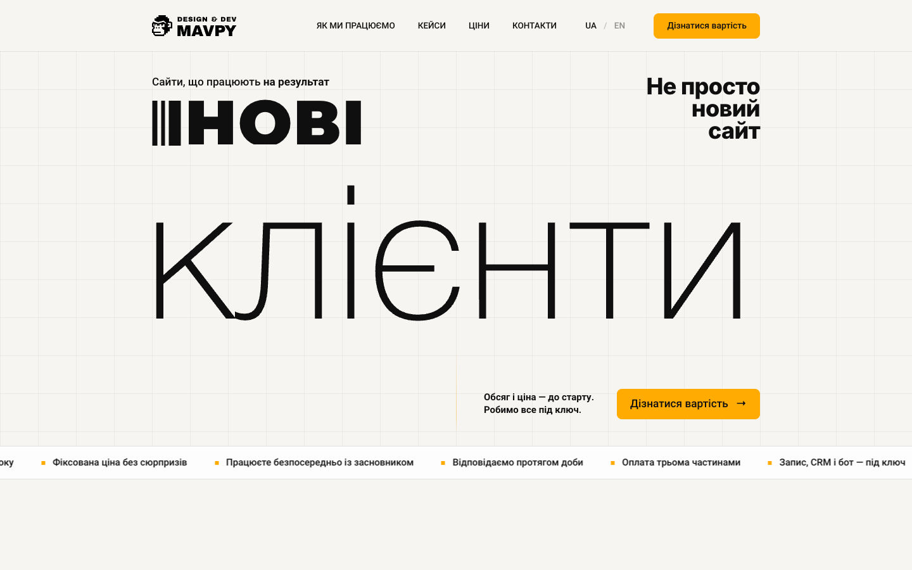
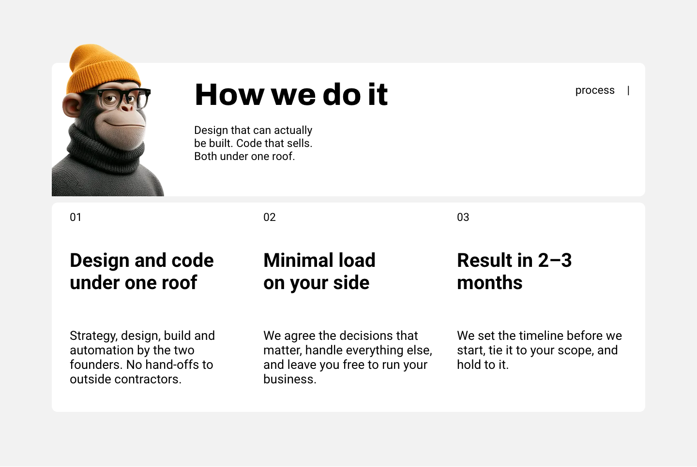
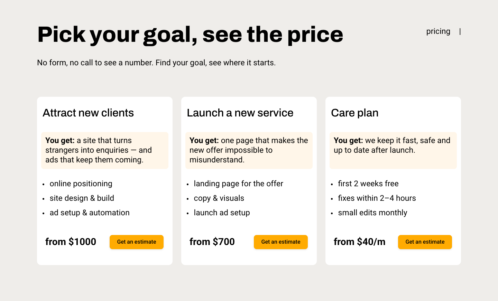
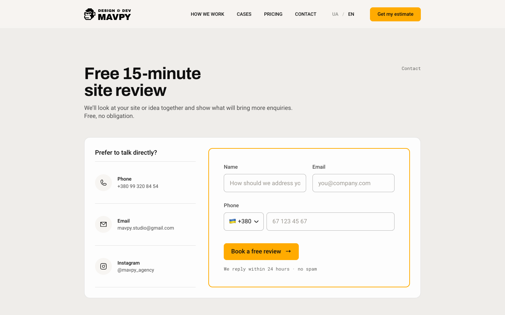

# MAVPY studio site

One-page site for the MAVPY (Мавпи) web studio, in English (`/`) and Ukrainian (`/uk/`), with a contact form that delivers leads to Telegram and Airtable.

| English                                              | Ukrainian                                              |
| ---------------------------------------------------- | ------------------------------------------------------ |
|  |  |

| How we work                                                      | Pricing                                                  |
| ---------------------------------------------------------------- | -------------------------------------------------------- |
|  |  |
| **Cases**                                                        | **Contact form**                                         |
|              |  |

<!-- Desktop 1440 px @1x, from production. Retake after Serhii's fixes. -->

## Stack

- [Astro](https://astro.build) 7 + TypeScript (strict). Pages are pre-rendered static HTML; only the form action runs on the server.
- Tailwind CSS v4. Design tokens live in `@theme` in `src/styles/global.css`.
- Hosting: Vercel via `@astrojs/vercel`.
- Fonts: Roboto, Archivo and BBH Hegarty from Fontsource; Helvetica Neue Thin self-hosted in `public/fonts/`.
- `@astrojs/sitemap` writes the sitemap with hreflang alternates. `robots.txt` is generated by `src/pages/robots.txt.ts`.

## Getting started

Requires Node 22+.

```sh
npm install
cp .env.example .env   # fill in the values, see below
npm run dev            # http://localhost:4321
```

| Command           | What it does                    |
| ----------------- | ------------------------------- |
| `npm run dev`     | Dev server with hot reload      |
| `npm run build`   | Production build into `dist/`   |
| `npm run preview` | Serve the production build      |
| `npm run check`   | Type-check (`astro check`)      |
| `npm run format`  | Format everything with Prettier |

## Environment variables

Set them in `.env` locally and in the host's project settings for production. All are optional: a channel with missing values is skipped, and a lead counts as delivered if at least one channel accepts it.

| Variable             | Used for                                                                                                                      |
| -------------------- | ----------------------------------------------------------------------------------------------------------------------------- |
| `TELEGRAM_BOT_TOKEN` | Bot token from @BotFather                                                                                                     |
| `TELEGRAM_CHAT_ID`   | Chat id of the studio group the bot is in (a negative number)                                                                 |
| `AIRTABLE_TOKEN`     | Personal access token with `data.records:write` on the base                                                                   |
| `AIRTABLE_BASE_ID`   | Base id (`app...`)                                                                                                            |
| `AIRTABLE_TABLE`     | Table name, default `Leads`. Fields: Name, Email, Goal, Locale, Page, Status                                                  |
| `RESEND_API_KEY`     | Auto-reply e-mail to the visitor. No key means no auto-reply                                                                  |
| `MAIL_FROM`          | Sender, e.g. `MAVPY <hello@your-domain>`. Needs a domain verified in Resend; empty uses Resend's test sender                  |
| `PUBLIC_GA_ID`       | GA4 measurement id (`G-...`). Empty = no analytics. Set = cookie banner; gtag loads only after Accept. Baked in at build time |

Delivery code is in `src/lib/leads.ts`; the form action and its validation are in `src/actions/index.ts`.

## Editing copy and translations

All text lives in two files:

- `src/i18n/en.ts`: English
- `src/i18n/uk.ts`: Ukrainian

Both have the same keys, and `uk.ts` is typed against the English one, so `npm run check` fails if a key is missing or misspelled in either file. To change a line, find it in `en.ts`, edit it, then edit the same key in `uk.ts`. Components never contain text of their own.

Markers to look for:

- `TODO(copy)`: placeholder waiting for real content.
- `// review: Serhii`: draft Ukrainian translation that hasn't been approved yet.

Ukrainian text is often 15 to 30% longer than English, so check `/uk/` on a phone-width window after editing.

## Project layout

```
src/
  layouts/Base.astro       <head>, SEO meta, hreflang, fonts
  components/sections/     one component per page section
  components/ui/           Button, Card, Container, Heading, Input, Section
  i18n/                    copy (en.ts, uk.ts) and helpers (utils.ts)
  pages/                   index.astro (EN), uk/index.astro (UK), 404, robots.txt
  actions/index.ts         contact form action
  lib/leads.ts             lead delivery (Telegram, Airtable, Resend)
  assets/                  images, icons, logos (optimised at build time)
public/                    favicons, OG image, self-hosted font
docs/                      design audit and full-size Figma frame exports
```

## Before launch

`robots.txt` blocks all crawlers while the site is a preview. At launch, set `indexable = true` in `src/pages/robots.txt.ts` and change `site` in `astro.config.mjs` to the real domain (canonical URLs and the sitemap use it).
